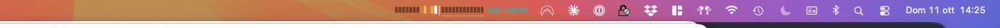
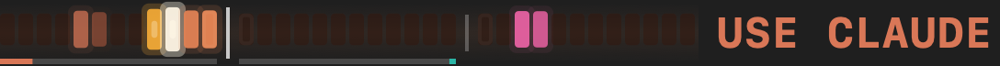
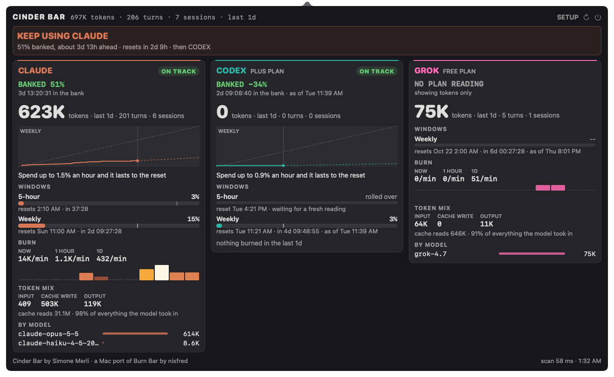
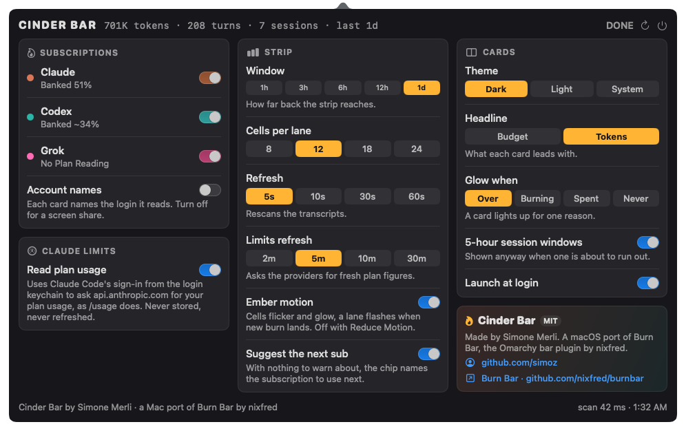

# Cinder Bar

> **Cinder Bar is a macOS port of [Burn Bar](https://github.com/nixfred/burnbar),
> the Omarchy bar plugin by [nixfred](https://github.com/nixfred).**
> The idea, the pacing and guidance rules, the transcript parsing rules and the
> visual design all come from Burn Bar. Cinder Bar re-implements them as a native
> Swift menu-bar app for the Mac. It is an independent port and is not
> affiliated with or endorsed by the original author. MIT licensed, like the
> original.

A live thermal strip in the macOS menu bar for anyone paying for more than one
AI subscription. It reads what **this Mac actually uses** (Claude Code,
Codex and Grok), turns it into one heat map, and tells you **what to do**: which
subscription has budget in the bank, which one needs a rest and until when, and
which one to reach for next.



## The strip

```
CLAUDE ◄── time ──┤ now ├── time ──► CODEX │ GROK ──►   CHIP
```



Claude burns on the left and Codex on the right. The newest bucket of each
sits against the centre divider, so the divider is always "now" and time
radiates outward. Grok follows Codex behind a thin rule, newest on its left. Colour carries the token count on a ramp from cold ember
through the agent's colour and amber to white-hot. Height is only a secondary
swell. The thin line under each lane is its plan gauge, which turns amber when
the plan is over pace and red when it is spent.

The strip glows as Burn Bar's does. Hot cells flicker like embers and bloom
past their edges, and a white-hot filament appears only in a cell at the top of
the scale. The strip sits on a faint bed of light that brightens with total
burn. A lane flashes when new burn lands, and the cell at "now" breathes. A plan
gauge past 90% beats, and so does a warning chip. At most one thing pulses: while
a 5-hour chip shows, everything else holds still. Every frame costs macOS a
redraw of the menu bar item, so the strip animates at 4 frames a second while
something burns, briefly faster through a flash, and not at all at rest.
**Ember motion** in SETUP turns it off, and so does Reduce Motion in System
Settings › Accessibility.

The chip beside the cells gives guidance, not multipliers. While a sub is past
an even spend it says what to do (`CLAUDE REST 8H`, `CODEX SPENT`,
`CLAUDE 5H OUT IN 40M`). With nothing to warn about it names the sub to use
next, in that sub's colour.

## The cockpit

Click the strip. A guidance banner (`USE CODEX NEXT`, `KEEP USING CLAUDE`,
`USE CODEX NOW: use it or lose it`) sits above one card per subscription:



- **Verdict**: ON TRACK, AT PACE, OVER or WAY OVER. Over starts 5% past an
  even spend.
- **What to do**: `BANKED 49%` with a running clock of time in the bank,
  `COME BACK IN 8:36:42` if you stop, `BACK AT THE RESET`, or `ON PACE`.
- **Headline**: budget (share of the plan spent) or tokens. Click it to flip.
- **Burndown**: an even-spend diagonal, the measured line and a projection.
- **Instruction**: how much you can spend per hour and still make the reset,
  and when the plan runs dry at the current rate.
- **Windows**: every limit the provider reports, with a gauge, an even-spend
  tick and the reset. A window whose reset has passed reads "rolled over" and
  its figure is withheld.
- **Burn, token mix, by model.**



SETUP (top right of the panel) holds every option: lanes, strip window and
cell count, refresh rates, card headline, glow reason, 5-hour session windows
and launch at login. `R` refreshes.

## The rules it keeps

These are Burn Bar's rules, ported unchanged and covered by tests:

- **It needs a choice.** It suggests nothing unless there are two
  subscriptions.
- **Only a sub that is ahead is ever suggested.** The winner has the most plan
  left against the clock it has left, which compares a week and a month on the
  same scale.
- **A full 5-hour window blocks a sub**, and so does one that will be full
  within half an hour.
- **A snapshot is not treated as exact.** Codex only reports its quota when
  Codex runs, so an older reading needs five times the margin and says when it
  was measured (`BANKED ~44% · as of Thu 11:55 AM`). Grok logs its quota only
  when Grok starts, so it always needs that margin, and 25% once Grok has been
  used since (`as of Sun 1:50 PM, used since`).
- **A plan change is not a reset.** Moving from SuperGrok Plus to Heavy took
  the weekly figure from 14% to 8% with the same reset, because the same week
  was measured against a bigger pool. The window stays whole. Only the samples
  from before the change are dropped, and the card says `upgraded to Heavy Mon
  8:58 PM`.
- **It does not flap.** The current pick keeps the job until another sub is
  clearly better.
- **A lane you untick is left out**: no cells, no card, no advice.

## Install

Cinder Bar needs macOS 14 or later.

**From a release.** Download `Cinder-Bar-<version>.zip` from
[Releases](https://github.com/simoz/cinderbar/releases), unzip it and move
`Cinder Bar.app` to `/Applications`. The app is not notarised, so macOS blocks
it the first time it opens. Clear the quarantine flag once:

```sh
xattr -dr com.apple.quarantine "/Applications/Cinder Bar.app"
```

You can also go to System Settings › Privacy & Security and choose
**Open Anyway** after the first attempt.

Opened from anywhere other than Applications, Cinder Bar offers to move itself
there and relaunch. The first time it runs from Applications it turns on
**Launch at login**, so it is in the menu bar every time you start the Mac. You
can turn that off in SETUP.

**From source.** You need the Xcode Command Line Tools
(`xcode-select --install`). Full Xcode is not required.

```sh
./scripts/bundle.sh             # builds "dist/Cinder Bar.app"
INSTALL=1 ./scripts/bundle.sh   # builds it and installs it in /Applications
ZIP=1 ./scripts/bundle.sh       # builds it and zips it for a release
```

While developing, use `swift run CinderBar`. The icon is drawn by
`swift scripts/make-icon.swift Resources/AppIcon.icns`.

Two diagnostic modes:

```sh
swift run CinderBar --print            # one collector run, a text summary, exit
swift run CinderBar --render out/      # writes strip.png and cockpit-*.png
```

For screenshots of the real panel, `--show` opens the cockpit at launch and
`--show-setup` opens SETUP.

Tests run without Xcode, because the Command Line Tools ship neither XCTest nor
the swift-testing macros:

```sh
swift run cinderbar-checks
```

## Uninstall

1. Open the panel, go to SETUP and turn off **Launch at login**. This removes
   Cinder Bar from System Settings › General › Login Items.
2. Quit it with the power button at the top right of the panel.
3. Move `Cinder Bar.app` from Applications to the Trash.
4. Remove its data and settings:

```sh
rm -rf ~/Library/Application\ Support/CinderBar
defaults delete dev.cinderbar.CinderBar
```

The first command removes the scan cache and the pace history. The second
removes the SETUP preferences. Cinder Bar never writes to your Claude, Codex or
Grok files, so nothing else needs cleaning up.

If you deleted the app before step 1 and it still appears in Login Items,
remove it there with the minus button.

## Where the numbers come from

- **Claude**: `~/.claude/projects/**/*.jsonl`. Assistant lines carry
  `message.usage`. The same message is re-serialized as it streams, so
  `message.id` is the dedupe key and the largest revision counts. The heat map
  counts fresh input, cache writes and output. Cache reads are carried
  separately for the token mix.
- **Codex**: `~/.codex/sessions/YYYY/MM/DD/rollout-*.jsonl`. The `token_count`
  events carry a cumulative counter, and Cinder Bar counts the deltas. The same
  events carry `rate_limits` (the 5-hour and weekly windows, and the plan),
  which is Codex's plan meter.
- **Grok**: `$GROK_HOME`, `~/.grok` by default.
  The Grok CLI (1.0.52 on) writes `sessions/**/usage.json`, a per-turn ledger
  it rewrites in place. Each turn counts once, keyed by session and turn number,
  and the latest content wins. Fresh input is `inputTokens` less
  `cachedReadTokens`, cache writes are `cacheCreationTokens`, and output is
  `outputTokens`, which already includes reasoning. Cache reads are carried
  separately, as for Claude. The model is the turn's `primaryModelId`. A
  session without a `usage.json` (older Grok builds) falls back to an estimate:
  `sessions/**/updates.jsonl` carries `_meta.totalTokens`, the running context
  size, for each `promptId`, and a prompt's burn is the rise of that figure
  within the prompt. A prompt whose figure does not change adds nothing, and
  `summary.json` names the model. The Free plan logs no credit figure, so its
  card shows tokens only. The
  weekly credit figure and the plan (`SuperGrok Heavy` is shown as `HEAVY
  PLAN`) come from the `billing: fetched credits config` lines in
  `logs/unified.jsonl`. The card's account line is the newest sign-in's email
  in `auth.json`.
- **Claude limits**: Claude Code writes no quota into its transcripts, so Cinder Bar
  asks the endpoint that Claude Code's own `/usage` uses
  (`api.anthropic.com/api/oauth/usage`). It uses the sign-in that Claude Code
  already keeps in the login keychain, read through `/usr/bin/security`.
  The endpoint is undocumented and may change. Every field is read defensively,
  and anything that does not parse is withheld rather than shown as 0%. You can
  turn this off in SETUP. Cinder Bar then shows Claude in tokens only.

Scanning is incremental. An unchanged file replays its cached contribution. A
file that grew is read from the previous offset, but only if the 48 bytes
before that offset still match. Cinder Bar's state lives in
`~/Library/Application Support/CinderBar/`: the scan cache and the history of
measured percentages that the burndown is drawn from.

## Privacy

Cinder Bar reads your Claude, Codex and Grok transcripts on this Mac to count tokens. It
keeps numbers, model names and message ids, never message text. Each card's
account label comes from one field of the file where that tool keeps its
sign-in: `oauthAccount.emailAddress` (else the display name) in
`~/.claude.json`, the email in the ChatGPT `id_token` of `~/.codex/auth.json`
(or `API key` for an API-key login), and the newest email in Grok's
`auth.json`. The tokens in those files are never copied, logged or stored. **Account names** in SETUP hides
the label for a screen share. The only
network request it makes is the Claude limits probe described above. That
request goes only to `api.anthropic.com`, using the token Claude Code already
holds. The token is never stored, logged or refreshed, because refreshing it
would rotate Claude Code's own sign-in.

## Differences from Burn Bar

Cinder Bar covers part of Burn Bar so far:

- Lanes for Claude, Codex and Grok. Kimi, Zcode and the local Ollama/GPU
  lane are not ported yet.
- No rising sparks, and the lane flash is a glow rather than Burn Bar's
  shockwave: at 18 points tall the menu bar has no room for either.
- The motion runs at 4 frames a second rather than Burn Bar's 20, because macOS
  re-snapshots the menu bar item on every frame.
- The burndown line is drawn from percentages Cinder Bar itself has measured, so it
  fills in over time after install.

## Credits

- Cinder Bar by **Simone Merli** ([@simoz](https://github.com/simoz)).
- [Burn Bar](https://github.com/nixfred/burnbar) by
  [nixfred](https://github.com/nixfred), the Omarchy plugin this is a port of.
  Go and star it.

## License

MIT. See [LICENSE](LICENSE), which carries both the Cinder Bar copyright and the
original Burn Bar copyright.
